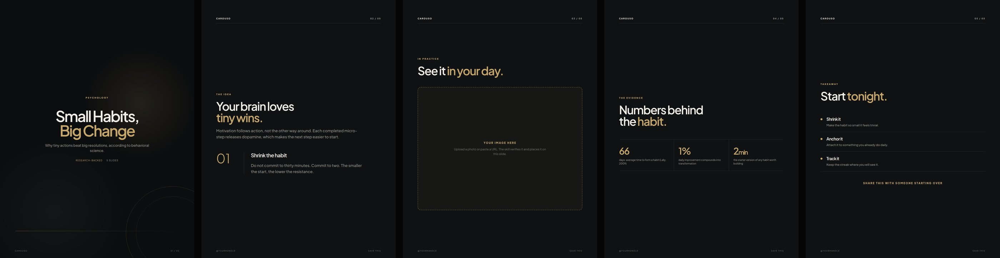
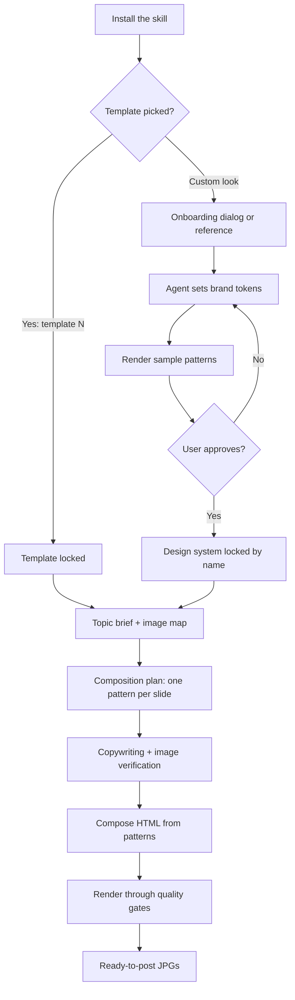

<div align="center">

# Carouso

**An AI agent skill for scroll-stopping carousel posts.**

Turn a topic into a designed, ready-to-post carousel for Instagram, TikTok, or Facebook.
One locked design system. Every carousel composed fresh. Real images only. No AI slop.



*Six slides, six different patterns, one brand. Tokens stay locked. Composition stays free.*

</div>

---

## Why Carouso

| | |
|---|---|
| **Design system, not a template** | Brand tokens (colors, fonts, spacing) stay locked. Layouts are composed per topic from a 12-pattern library. Consistent, never templated. |
| **Ready to use** | Six numbered templates. Say `template 3, topic: ...` and get finished JPGs. No setup, no onboarding, fonts included. |
| **Or your own look** | Want a custom brand instead? A 7-question dialog (or a reference screenshot) locks your own design system. |
| **Real images only** | Images come from user uploads or URLs. Every image passes visual verification. Generative AI imagery is banned, no exceptions. |
| **Quality gates** | The render fails on wrong slide count, overflowing content, wrong dimensions, or an unloaded webfont. Defects never ship silently. |

## Pick a template

Every template is a finished 8-slide look: colors, fonts, light and dark slides, and a slide order that works. Pick a number, give a topic, get a carousel.

```
template 3, topic: 5 habits that waste your week
```

The agent asks once for anything missing (brand name and handle, optional images), writes the copy, and renders print-clean JPGs at 1080x1440. The sample copy in the previews is placeholder.

### 01 · Morning Cup
Playful and friendly. Warm earth tones, rounded type. Good for food, lifestyle, small brands.


### 02 · Clean Minimal
Clean and minimal. Lots of white space, one cool blue accent. Good for tips, tools, productivity.


### 03 · Bold Contrast
Bold and striking. Black and off-white, one hot accent, heavy type. Good for hot takes and hooks.


### 04 · Warm Elegant
Warm and elegant. Cream and burgundy, serif headlines. Good for wellness, beauty, slow living.


### 05 · Dark Premium
Dark and premium. Near-black and antique gold, editorial quotes. Good for finance, business, expertise.


### 06 · Fresh Garden
Fresh and natural. Sage and leaf green, soft rounded type. Good for health, nature, how-tos.


Need a different slide count (5 to 10), your own images, or another pattern for one slide? Say so in the brief. Templates stay locked, so the look never drifts.

---

## How it works



**Template path (default).** Pick a number and send a topic. Phase 1 is already done for you.

**Phase 1, custom only: lock a design system.** Answer 7 quick questions, or send a screenshot or HTML file you like as reference. The agent sets your brand tokens, renders sample patterns in them, and iterates with you until you approve. Name it (for example `morningcup-playful`). Build more named systems anytime and pick one per carousel.

**Phase 2: compose carousels.** For each new topic the agent plans a composition (one pattern per slide, never repeating the previous carousel's cover), writes the copy, verifies and places your images, and renders print-clean JPGs. Variety is enforced by hard rules, not left to chance.

## The onboarding dialog (custom design system only)

Skip this when you use a template.

| # | Question | Choices |
|---|---|---|
| 1 | What vibe should the carousel have? | Playful and friendly / Clean and minimal / Bold and striking / Warm and elegant / Dark and premium |
| 2 | Pick a color mood. | Warm earth / Fresh natural / Ocean calm / Bold contrast / Soft pastel |
| 3 | Pick a type feel. | Rounded and playful / Elegant serif / Bold and modern / Clean and simple |
| 4 | Brand name and handle for the watermark? | Free text |
| 5 | What are the carousels usually about? | Free text |
| 6 | Indonesian or English? | Two choices |
| 7 | What should we call this design system? | Free text |

Font choices stay at the feel level. The agent maps them to real fonts internally. No font names, no jargon. All fonts are bundled in `fonts/`.

## The pattern library

Twelve structural patterns in `design-system/`, all token-driven. Each slide can also flip to the system's dark mode with one class (`mode-dark` on the `<section>`), so a carousel can alternate light and dark slides without any redesign.

| Pattern | Use for |
|---|---|
| cover-big-type, cover-split | Opening hooks |
| kicker-statement | Editorial openers, strong claims |
| stat-band, big-number | Numbers and research |
| concept-number | One big idea per slide |
| quote | A line worth remembering |
| two-cards | Paired ideas, do vs don't |
| image-hero | A photo that carries the slide |
| process-steps | Sequences and how-tos |
| myth-fact | Correcting a misconception |
| takeaway | Closers, recaps, CTAs |

## Design standards

Every slide is held to the same bar:

- **Hierarchy.** The headline is the largest, boldest element. One accent-colored word per headline.
- **Contrast.** Text over photos sits on a scrim or card. Never on a busy photo directly.
- **Typography.** Two font families maximum. Every font must load, or the render fails.
- **Color.** 60 percent base, 30 percent secondary, 10 percent accent.
- **Copy.** Short declarative sentences. Concrete nouns and strong verbs. No AI tells: no em dashes, no "delve", no "unlock", no filler openers.
- **Consistency.** Tokens never change across slides. Patterns vary. That is the whole trick.
- **Two modes.** Every template and system ships a light and a dark token set. Slides alternate modes. Templates fix the order, custom systems open each carousel with the opposite mode of the last one.

## Quick start

1. Copy the `carouso/` folder into your agent's skills directory (`~/.claude/skills/`, `~/workspace/skills/`, or your platform's skills folder).
2. Install the renderer once: `pip install playwright && playwright install chromium`.
3. Tell your agent: `template 2, topic: how to write notes you will reopen`.
4. Get back `slide_01.jpg` to `slide_08.jpg` in `carousels/<name>/`.

Want your own brand instead? Ask for a custom design system and answer the 7 questions.

## Package contents

```
carouso/
├── SKILL.md                  ← the whole skill: workflow, design thinking, gates
├── templates/
│   └── NN-name/              ← six templates, each with:
│       ├── tokens.css        ←   colors, fonts, light and dark modes
│       ├── template.json     ←   name, fonts, size, slide sequence
│       └── sample.html       ←   the finished 8-slide sample to copy from
├── design-system/
│   ├── system.css            ← structure + all 12 pattern styles (shared by every template)
│   ├── patterns.html         ← the 12 patterns as full slides
│   └── PATTERNS.md           ← catalog: what each pattern is for
├── fonts/                    ← bundled variable fonts (SIL OFL) + fonts.css
├── assets/
│   ├── preview-all.jpg       ← six demo slides in one strip
│   └── templates/            ← the six template previews
├── scripts/
│   └── render_carousel.py    ← Playwright render with quality gates
└── examples/
    └── brief-example.md      ← a complete brief and how the skill handles it
```

Output goes to `carousels/<name>/` (git-ignored).

## Render requirements

- Python 3 plus `playwright` (`pip install playwright && playwright install chromium`)
- Nothing else. Fonts are bundled in `fonts/`, so the font gate passes on a clean machine.

## Rules the skill never breaks

1. No template and no approved design system, no production.
2. Compose from the pattern library. No per-carousel layout inventions.
3. Variety rules are hard rules: no adjacent duplicate patterns, alternating light and dark slides.
4. Images from uploads or URLs only. No generative AI imagery.
5. Every image is visually verified before use.
6. A failed quality gate means fix the HTML, never bypass the gate.
