<div align="center">

# Carouso

**An AI agent skill for scroll-stopping carousel posts.**

Turn a topic into a designed, ready-to-post carousel for Instagram, TikTok, or Facebook.
Pick a ready-made template or lock your own design system. Real images only. No AI slop.

</div>

---

## Why Carouso

| | |
|---|---|
| **Locked tokens, free layouts** | Brand tokens (colors, fonts, spacing) stay locked. Slides are composed per topic from a 19-pattern library, so every carousel is consistent without looking copy-pasted. |
| **Ready to use** | Eleven numbered templates. Say `template 3, topic: ...` and get finished JPGs. No setup, no onboarding, fonts included. |
| **Or your own look** | Want a custom brand instead? A 7-question dialog (or a reference screenshot) locks your own design system. |
| **Real images only** | Images come from user uploads or URLs and every one passes visual verification. Four photo layouts ship with the skill. Generative AI imagery is banned, no exceptions. |
| **Built for phones** | Body copy is 28 to 32px, nothing is under 20px, and text keeps WCAG AA contrast (4.5:1) in both modes. |
| **Quality gates** | The render fails on wrong slide count, overflowing content, wrong dimensions, text under 20px, or a missing font. Defects never ship silently. |

## Pick a template

Every template is a finished 8-slide look: colors, fonts, light and dark slides, and a slide order that works. Pick a number, give a topic, get a carousel.

```
template 3, topic: 5 habits that waste your week
```

The agent asks once for anything missing (brand name and handle, optional images), writes the copy, and renders print-clean JPGs at 1080x1440. The sample copy in the previews is placeholder.

### 01 · Morning Cup
Playful and friendly. Warm earth tones, rounded type. Good for food, lifestyle, small brands.

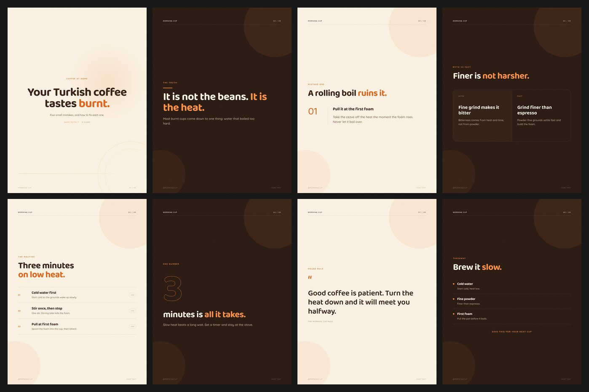

### 02 · Clean Minimal
Clean and minimal. Lots of white space, one cool blue accent. Good for tips, tools, productivity.

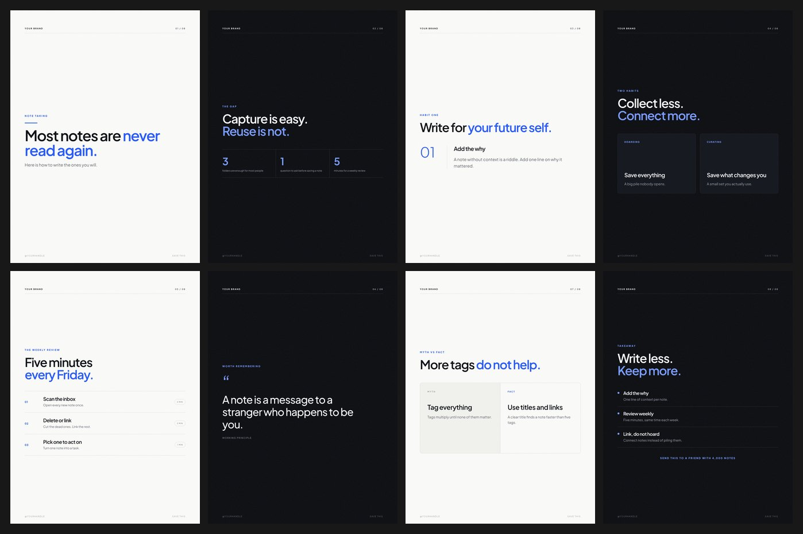

### 03 · Bold Contrast
Bold and striking. Black and off-white, one hot accent, heavy type. Good for hot takes and hooks.

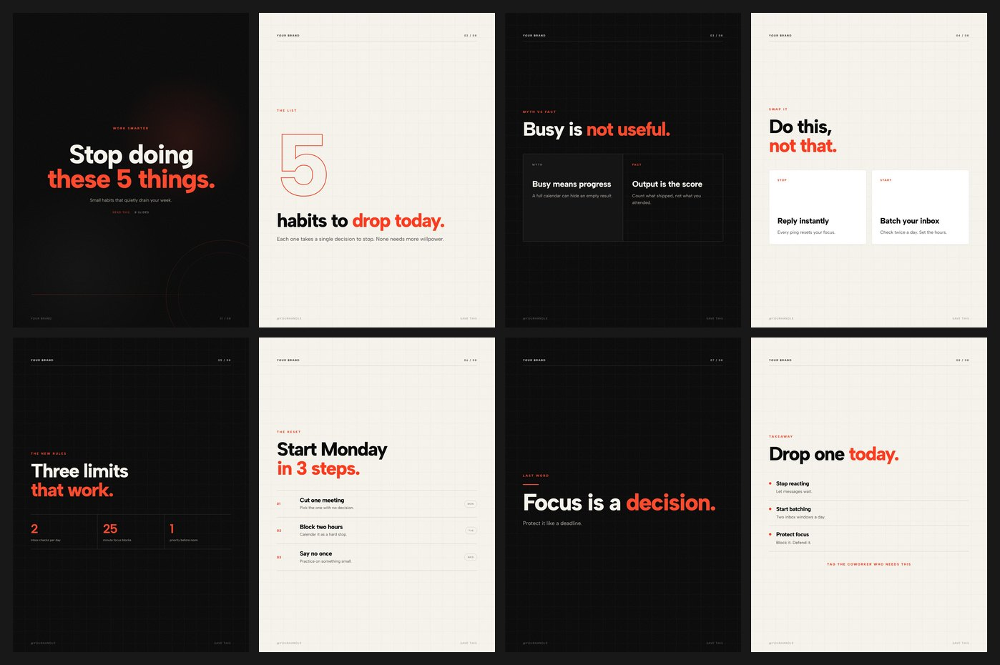

### 04 · Warm Elegant
Warm and elegant. Cream and burgundy, serif headlines. Good for wellness, beauty, slow living.

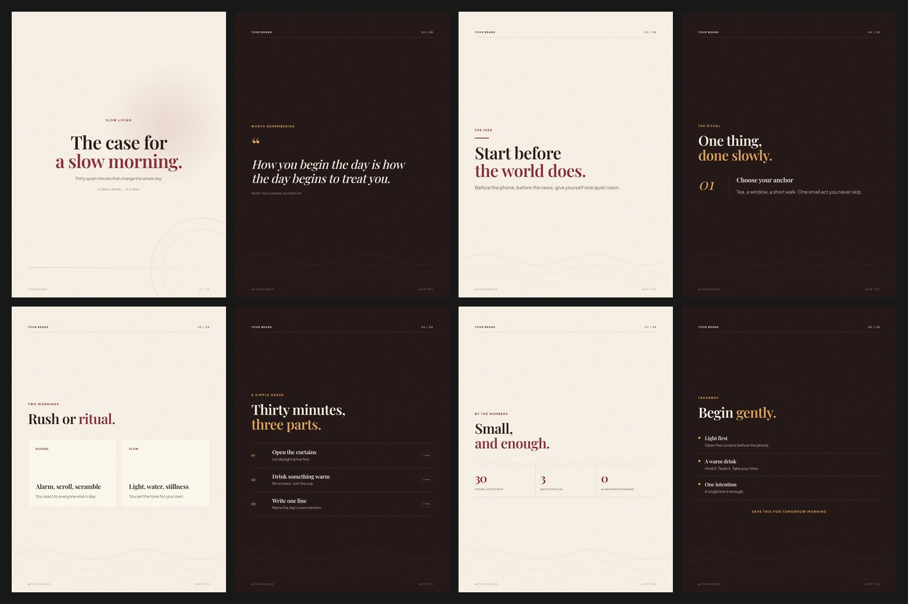

### 05 · Dark Premium
Dark and premium. Near-black and antique gold, editorial quotes. Good for finance, business, expertise.

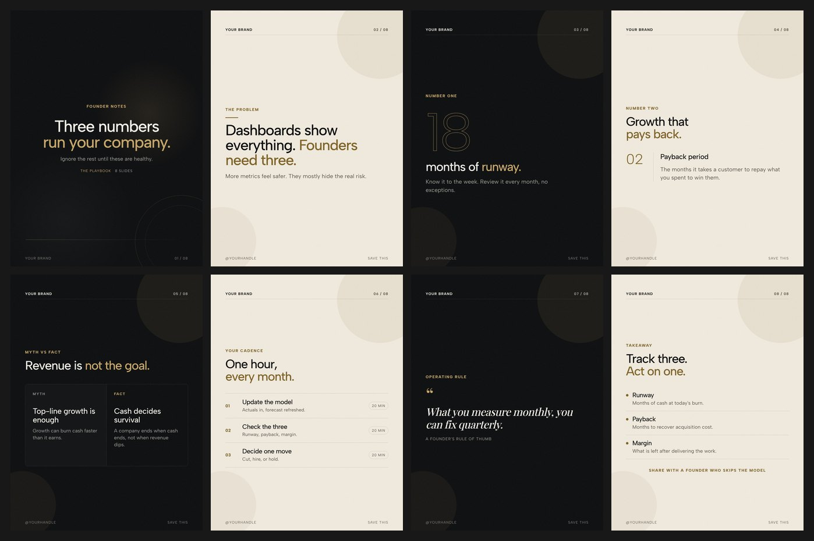

### 06 · Fresh Garden
Fresh and natural. Sage and leaf green, soft rounded type. Good for health, nature, how-tos.

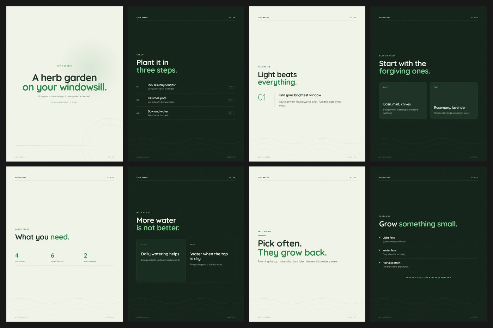

### 07 · Paper Stack
Teal and peach. A big left-aligned headline over a stack of paper sheets, graph-paper body slides, highlighter underlines on the key words and a segmented progress bar. Comes in three palettes: the default teal, `skin-sand` (warm sand and espresso) and `skin-slate` (cool slate and sky). Good for tutorials, tools, education.

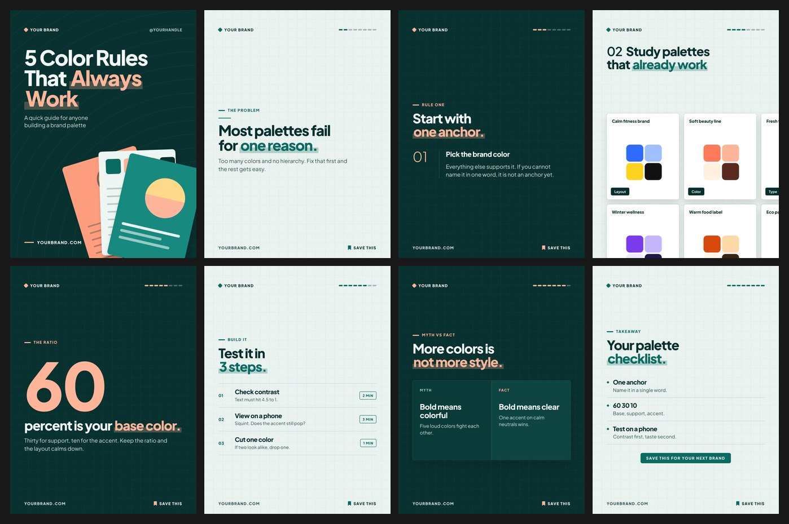

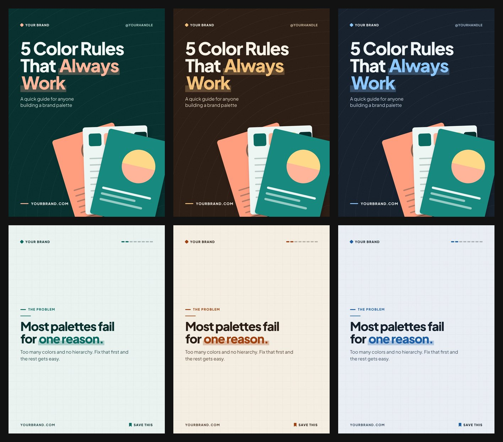

*Default, `skin-sand`, `skin-slate`. Put the skin class on `<body>`.*

### 08 · Tape Label
Butter and charcoal. Huge left-aligned type with one word on a tilted paper label, taped label headlines, die-cut stickers and a hazard-tape footer band. Good for tips, creative and playful topics.

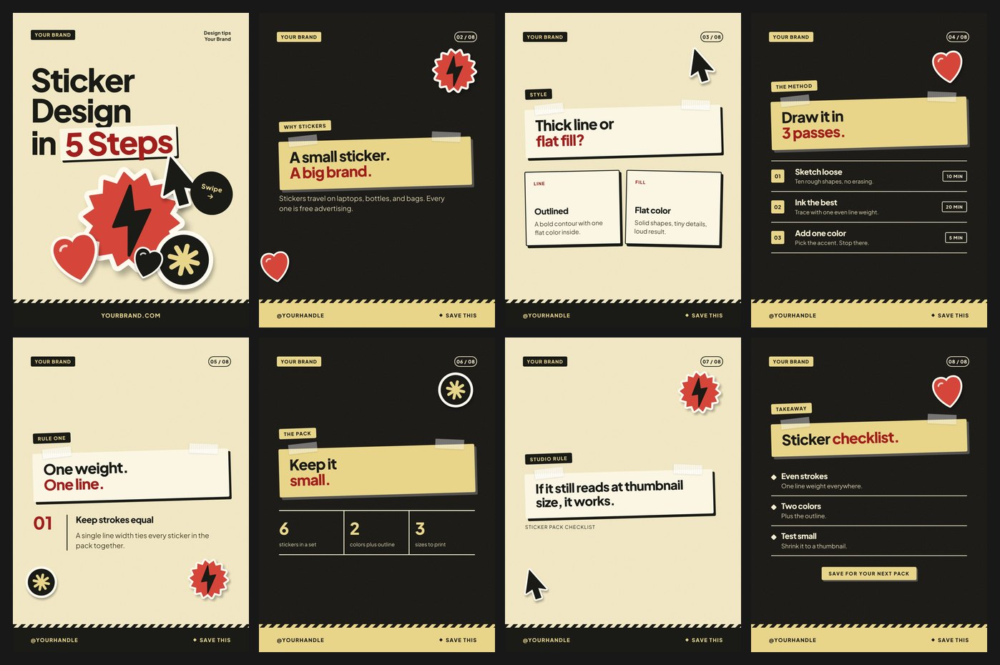

### 09 · Clean Object
White space, heavy grotesk headlines with a serif italic accent, a yellow pill, glossy objects and a numbered gallery that peeks off the edges. Good for design, business, creator content.

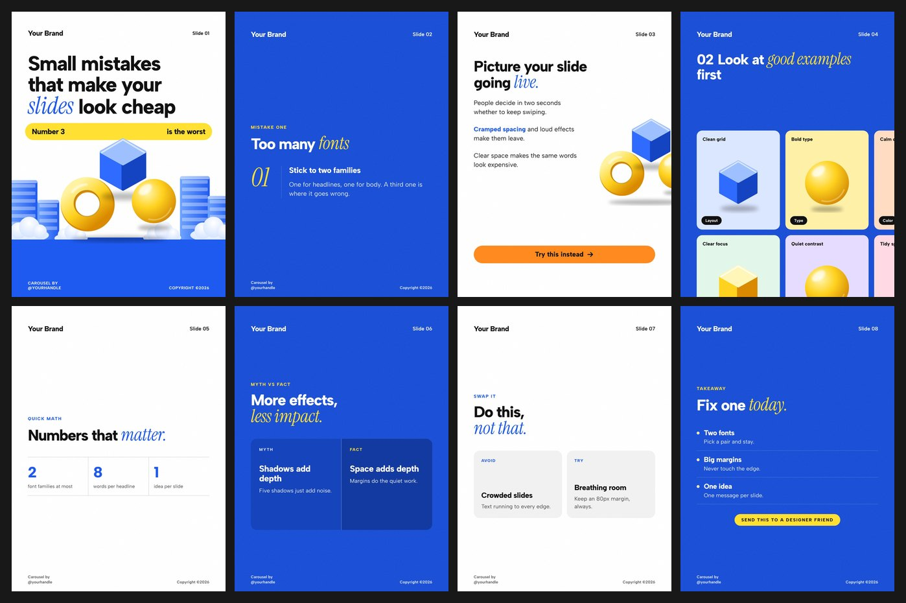

### 10 · Sticky Mono
Flat orange or paper slides, monospace notes, a sticky number tab and marker highlights. Good for stories, career notes, long-form tips.

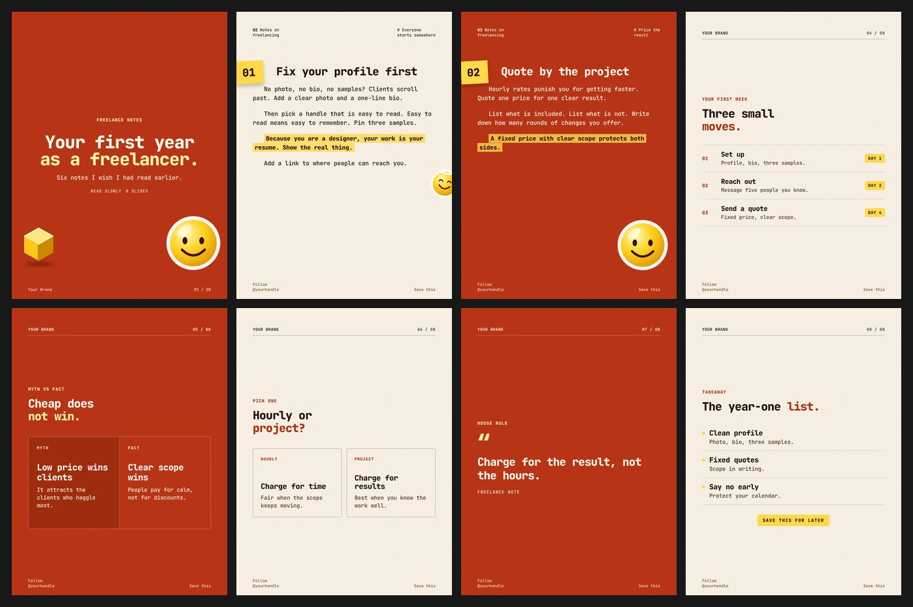

### 11 · Neon Hook
Dark violet, a centered hook headline, a gradient CTA pill and glowing objects. Good for hooks, tech, short punchy explainers.

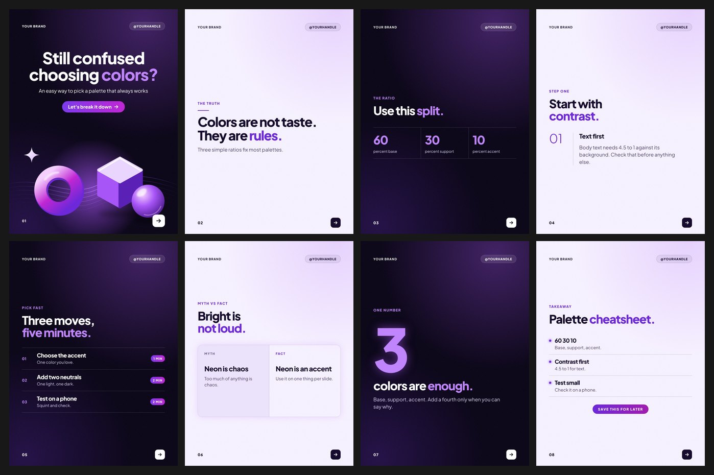

**About the hero objects.** Templates 07 to 11 draw their default art (paper sheets, glossy cubes, balls and rings, die-cut stickers) as SVG, so the previews need no photos. To use your own transparent PNG or photo, put an `` inside the `.object` element and it replaces the default. Generative AI imagery is still not allowed.

Need a different slide count (5 to 10), your own photos, or another pattern for one slide? Say so in the brief. Templates stay locked, so the look never drifts. The previews above use sample copy and no photos. See [Adding photos](#adding-photos).

---

## How it works

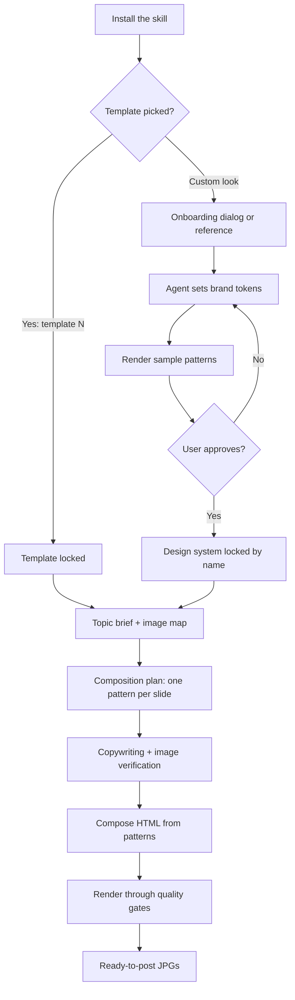

**Template path (default).** Pick a number and send a topic. Phase 1 is already done for you.

**Phase 1, custom only: lock a design system.** Answer 7 quick questions, or send a screenshot or HTML file you like as reference. The agent sets your brand tokens, renders sample patterns in them, and iterates with you until you approve. Name it (for example `morningcup-playful`). Build more named systems anytime and pick one per carousel.

**Phase 2: compose carousels.** For each new topic the agent plans a composition (one pattern per slide, no two neighbors alike, light and dark alternating), writes the copy, verifies and places your images, and renders print-clean JPGs. A custom system also never repeats the previous carousel's cover. Variety is enforced by hard rules, not left to chance.

## The onboarding dialog (custom design system only)

Skip this when you use a template.

| # | Question | Choices |
|---|---|---|
| 1 | What vibe should the carousel have? | Playful and friendly / Clean and minimal / Bold and striking / Warm and elegant / Dark and premium |
| 2 | Pick a color mood. | Warm earth / Fresh natural / Ocean calm / Bold contrast / Soft pastel |
| 3 | Pick a type feel. | Rounded and playful / Elegant serif / Bold and modern / Clean and simple |
| 4 | Brand name and handle for the watermark? | Free text |
| 5 | What are the carousels usually about? | Free text |
| 6 | Indonesian or English? | Two choices |
| 7 | What should we call this design system? | Free text |

Font choices stay at the feel level. The agent maps them to real fonts internally. No font names, no jargon. All fonts are bundled in `fonts/`.

## The pattern library

Nineteen structural patterns in `design-system/`, all token-driven. Each slide can also flip to the system's dark mode with one class (`mode-dark` on the `<section>`), so a carousel can alternate light and dark slides without any redesign.

| Pattern | Use for |
|---|---|
| cover-big-type, cover-split | Opening hooks |
| kicker-statement | Editorial openers, strong claims |
| stat-band, big-number | Numbers and research |
| concept-number | One big idea per slide |
| quote | A line worth remembering |
| two-cards | Paired ideas, do vs don't |
| image-hero | A photo that carries the slide (other photo layouts: see Adding photos) |
| process-steps | Sequences and how-tos |
| myth-fact | Correcting a misconception |
| takeaway | Closers, recaps, CTAs |

## Adding photos

Any body slide can take a photo. Give the agent the file (or a URL) and say which slide it belongs on. Each image is checked before use: it must match the slide topic, carry no watermark or foreign logo, and be sharp enough (shortest side 900px or more for large use). Four layouts, all skinned by the template tokens:

| Layout | What it looks like | Use for |
|---|---|---|
| One framed photo (`photo`) | 16:10 frame under the copy. `wide` (5:2) and `band` (3:1) for dense slides. | Most body slides |
| Two photos (`photos`) | Two square frames side by side, same gutter as `two-cards`. `short` (4:3) for dense slides. | Before and after, two examples |
| Full-bleed top (`photo-top`) | One photo edge to edge on top with rounded bottom corners. The topbar sits on it, the copy starts below. | Hero-style slides. Pick a photo with a calm top edge |
| Photo slide (`image-hero`, `cover-split`) | The photo is the slide. | Strong covers and showpiece images |

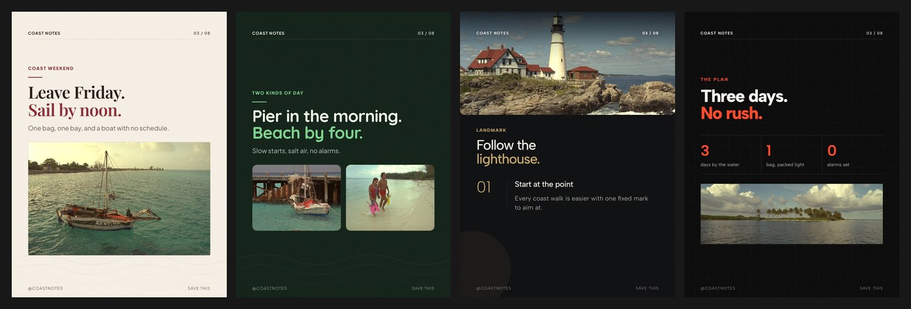

*Left to right: `photo` in Warm Elegant, `photos` in Fresh Garden, `photo-top` in Dark Premium, and `photo band` in Bold Contrast. Sample photos are from the Kodak Lossless True Color Image Suite, released by Kodak for unrestricted use.*

Every frame takes an optional caption on a scrim and a crop point (`--focus`). Details and markup are in `design-system/PATTERNS.md`.

## Design standards

Every slide is held to the same bar:

- **Hierarchy.** The headline is the largest, boldest element. One accent-colored word per headline.
- **Text on photos.** It sits on a scrim or card. Never on a busy photo directly.
- **Typography.** Two font families maximum. Every font must load, or the render fails. Body copy is 28 to 32px and nothing is smaller than 20px, so it stays readable on a phone.
- **Contrast.** Body, muted, footer, and accent text hold at least 4.5:1 against their background in both modes (WCAG AA).
- **Color.** 60 percent base, 30 percent secondary, 10 percent accent.
- **Copy.** Short declarative sentences. Concrete nouns and strong verbs. No AI tells: no em dashes, no "delve", no "unlock", no filler openers.
- **Consistency.** Tokens never change across slides. Patterns vary. That is the whole trick.
- **Two modes.** Every template and system ships a light and a dark token set. Slides alternate modes. Templates fix the order, custom systems open each carousel with the opposite mode of the last one.

## Quick start

1. Copy the `carouso/` folder into your agent's skills directory (`~/.claude/skills/`, `~/workspace/skills/`, or your platform's skills folder).
2. Install the renderer once: `pip install playwright && playwright install chromium`.
3. Tell your agent: `template 2, topic: how to write notes you will reopen`.
4. Get back `slide_01.jpg` to `slide_08.jpg` in `carousels/<name>/`.

Want your own brand instead? Ask for a custom design system and answer the 7 questions.

## Package contents

```
carouso/
├── SKILL.md                  ← the whole skill: workflow, design thinking, gates
├── templates/
│   └── NN-name/              ← eleven templates, each with:
│       ├── tokens.css        ←   colors, fonts, light and dark modes (07 to 11 also draw their object art from decor/)
│       ├── template.json     ←   name, fonts, size, slide sequence
│       └── sample.html       ←   the finished 8-slide sample to copy from
├── design-system/
│   ├── system.css            ← structure + all 19 pattern styles (shared by every template)
│   ├── patterns.html         ← the first 12 patterns as full slides (07 to 11 demo the newer seven)
│   └── PATTERNS.md           ← catalog: what each pattern is for
├── fonts/                    ← bundled fonts (SIL OFL) + fonts.css
├── assets/
│   ├── photo-layouts.jpg     ← the four photo layouts in four templates
│   └── templates/            ← the eleven template previews
├── scripts/
│   └── render_carousel.py    ← Playwright render with quality gates
└── examples/
    └── brief-example.md      ← a complete brief and how the skill handles it
```

Output goes to `carousels/<name>/` (git-ignored).

## Render requirements

- Python 3 plus `playwright` (`pip install playwright && playwright install chromium`)
- Nothing else. Fonts are bundled in `fonts/`, so the font gate passes on a clean machine.

## Rules the skill never breaks

1. No template and no approved design system, no production.
2. Compose from the pattern library and the photo layouts. No per-carousel layout inventions.
3. Variety rules are hard rules: no adjacent duplicate patterns, alternating light and dark slides.
4. Images from uploads or URLs only. No generative AI imagery.
5. Every image is visually verified before use.
6. A failed quality gate means fix the HTML, never bypass the gate.
